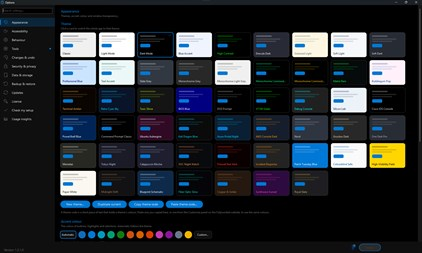

# FW Admin Tech Tools Pro for Windows Maintenance

[](https://fw-admin-tech-tools-pro.github.io/FW-Admin-Tech-Tools-Pro-Software/)

FW Admin Tech Tools Pro brings Windows maintenance, network diagnostics, file utilities, and other administrative tools into one application.
Fullyworked develops the suite for Windows 10 and Windows 11.

This guide presents FW Admin Tech Tools Pro Software through focused tasks and reviewable results.
Choose a tool according to the problem you are investigating.

The accompanying source snapshot belongs to Angry IP Scanner.
Its Java files illustrate a separate network scanner and are not the source code of FW.

## Features

The vendor groups the suite into categories covering system information, cleanup, networking, security, automation, and document tools.
Start with inspection before deciding which change is appropriate.

| Task area | Initial question | Useful evidence |
| --- | --- | --- |
| System information | What machine and Windows build are affected? | Version and hardware details |
| Disk usage | Which location accounts for the occupied space? | Folder sizes and available capacity |
| Application management | Which program and version need attention? | Installed-application inventory |
| Network diagnostics | Which interface or destination has the problem? | Address, DNS, and connectivity observations |
| File maintenance | Which files match the intended operation? | Previewed names and paths |
| Windows repair | What symptom or error is reproducible? | Error text and a baseline observation |

Use the FW Admin Tech Tools Pro utility for one defined task at a time.
Record the starting conditions so the result can be assessed afterward.


For comparison, Angry IP Scanner separates scan settings from interface settings.
The references are [ScannerConfig.java](src/net/azib/ipscan/config/ScannerConfig.java) and [GUIConfig.java](src/net/azib/ipscan/config/GUIConfig.java).

Those classes describe the reference scanner.
Their fields are not FW configuration options.

## How to use

Write down the symptom before opening a repair or cleanup tool.
Include when it occurs and which application, folder, or connection is affected.

A practical review follows this sequence:

1. Identify the affected machine and component.
2. Inspect the current state.
3. Choose the smallest relevant task.
4. Review the selected scope and settings.
5. Perform the intended operation.
6. Repeat the initial observation.
7. Record the result and any remaining problem.

Compare the FW Admin Tech Tools Pro admin tools by the job they perform.
A network scan, a DNS check, and a Windows repair address different questions.

The following example uses Windows PowerShell's NetTCPIP module.
It reads local interface configuration without changing addresses or DNS settings.

```powershell
Get-NetIPConfiguration |
    Select-Object InterfaceAlias, InterfaceIndex,
        IPv4Address, IPv4DefaultGateway, DNSServer |
    Format-List
```

This is a Windows command rather than a native FW command.
Use the displayed interface information when documenting a connectivity problem.

In the reference scanner, [RangeFeeder.java](src/net/azib/ipscan/feeders/RangeFeeder.java) supplies addresses from a range.
The alternative [FileFeeder.java](src/net/azib/ipscan/feeders/FileFeeder.java) reads targets from a file.

Keep the target selection consistent when comparing observations.
A result from one address range does not describe a different network segment.

The reference fetchers separate distinct observations:

- [PingFetcher.java](src/net/azib/ipscan/fetchers/PingFetcher.java) gathers ping timing information.
- [PortsFetcher.java](src/net/azib/ipscan/fetchers/PortsFetcher.java) checks selected TCP ports.
- [HostnameFetcher.java](src/net/azib/ipscan/fetchers/HostnameFetcher.java) retrieves hostnames.

These examples explain Angry IP Scanner responsibilities.
They do not establish the implementation used by FW's network tools.

## Settings

Check the scope before applying a change.
A selected folder, account, drive, or adapter can determine which part of the system is affected.

For repeatable work, record:

- The tool name and application version.
- The selected location or component.
- Any non-default setting.
- The observation before the operation.
- The result after the operation.

The vendor documents a Change Journal for reviewing changes and available undo actions.
Check the entry and its supported action instead of assuming that every operation can be reversed.

A change record serves a different purpose from an independent backup.
Retain copies of important files before operations that modify their contents.

In the reference project, [ResultTable.java](src/net/azib/ipscan/gui/ResultTable.java) presents scan results.
The companion [StatisticsDialog.java](src/net/azib/ipscan/gui/StatisticsDialog.java) summarizes scan information.

Keep detailed rows and aggregate totals separate when interpreting a report.
A summary can omit the specific item needed to explain a problem.



## Automation / Presets

Begin with a small manual task before repeating it automatically.
Confirm that the target selection still makes sense when the same task runs later.

A useful automation note identifies the trigger, target, expected output, and completion condition.
Record what should happen when an input file or destination is unavailable.

When a workflow provides an existing comma-delimited CSV report, inspect its columns before processing it.
The following Python example uses the standard library to read a header and count data rows.

```python
import csv

with open("report.csv", newline="", encoding="utf-8-sig") as stream:
    reader = csv.reader(stream)
    header = next(reader, [])
    row_count = sum(1 for row in reader if row)
print("Columns:", header)
print("Data rows:", row_count)
```

The example assumes a header row and UTF-8 text.
It is a general report-inspection example and does not prescribe an FW export schema.

For implementation references, Angry IP Scanner includes [CSVExporter.java](src/net/azib/ipscan/exporters/CSVExporter.java).
Its [XMLExporter.java](src/net/azib/ipscan/exporters/XMLExporter.java) handles another output format.

The coordinator is [ExportProcessor.java](src/net/azib/ipscan/exporters/ExportProcessor.java).
Those files implement reference-project exports, not FW automation.

## Build & Develop

The available source files explain parts of Angry IP Scanner.
They do not supply an FW build target, SDK, or extension API.

The reference [Scanner.java](src/net/azib/ipscan/core/Scanner.java) coordinates fetchers for a scan target.
The associated [ScanningResult.java](src/net/azib/ipscan/core/ScanningResult.java) holds the resulting values.

Command processing appears in [CommandLineProcessor.java](src/net/azib/ipscan/config/CommandLineProcessor.java).
Its existence does not establish a command-line interface for FW.

The reference logging configuration is [logging.properties](config/logging.properties).
Its Java logging settings belong to Angry IP Scanner.

Keep source inspection separate from running a scanner or modifying a system.
The presence of these files does not establish a complete, verified build environment.

## System requirements

The vendor describes FW as a Windows 10 and Windows 11 application.
Check the current distribution requirements for the machine where it will be used.

The Java dependencies of Angry IP Scanner describe a different product.
They do not establish FW's runtime requirements.

Record the FW Admin Tech Tools Pro app version when reporting a result.
Use the version shown by the installed application rather than inferring it from an older screenshot.

## Support

Include a reproducible sequence when describing a problem.
Provide the tool name, Windows build, selected scope, exact error text, and expected result.

Official resources:

- [Fullyworked product website](https://fullyworked.com.au/)
- [Tool directory and individual guides](https://fullyworked.com.au/Tools)
- [Change Journal documentation](https://fullyworked.com.au/TechToolsChangeJournal)
- [Microsoft Store listing](https://apps.microsoft.com/detail/9mz0f7b7cxzw)

The reference source files retain their own upstream licensing.
They do not grant rights to redistribute the commercial FW application.

## Related Search Terms

FW Admin Tech Tools Pro, FW Admin Tech Tools Pro Software, fw admin tech tools pro utility, fw admin tech tools pro admin tools, FW Admin Tech Tools Pro app, windows, windows-10, windows-11, administrator, monitoring, system-monitor, performance, security, powershell, gui
